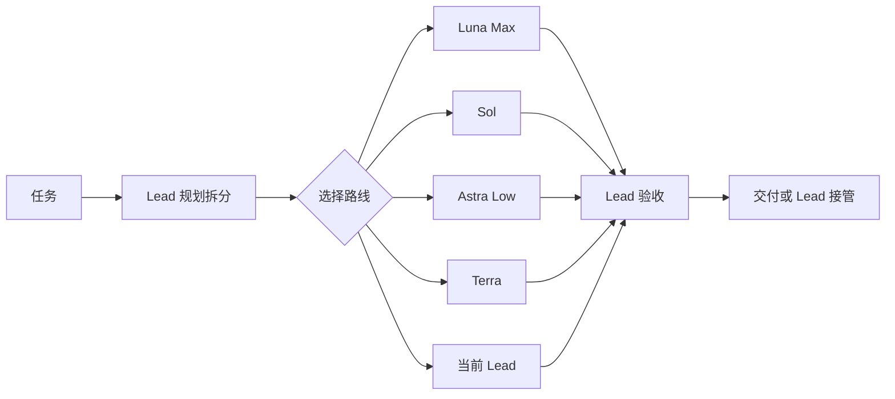
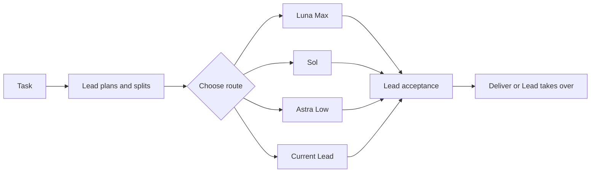

# Codex 路由矩阵

Lead 指当前 Astra 或 Sol 主控。Luna 明确不支持或无访问权限时，主控将原工作包和进度转给能可靠完成的 Sol 路线，并选择最低可靠档位；容量错误先由原代理在原上下文重试一次。质量失败由主控重新判断。

[中文](#中文) | [English](#english)

## 中文

Codex 路由矩阵是给 `gpt-6-astra` / `gpt-6.1-sol` 使用的多模型协作插件，已启动的 `gpt-6-sol` 仍兼容。它让 Lead 继续负责理解需求、规划、拆分、整合和最终验收，同时把边界清楚、适合独立执行的工作交给 Luna Max、Sol worker（Medium/High/XHigh/Max）、可选的 Astra Low 或 Terra worker（`gpt-6.1-terra`）。

它解决的不是“每个任务都换模型”，而是两个更实际的问题：复杂任务如何安全并行，以及如何在不降低质量的前提下控制总成本与端到端耗时。

### 运行原理

1. Lead 先理解任务，短任务或强耦合工作直接完成。
2. 需要拆分时，Lead 为每个工作单元写清目标、范围、文件归属、依赖和验收标准。
3. Luna 固定使用 Max，只接步骤已定、风险低且下派有净收益的工作：只读提取、格式整理、指定检查，或按 Lead 批准步骤进行的低风险代码编辑。独立诊断、设计或改共享状态留给 Sol/Lead；不把 Luna 当试错路线，也不依赖 Lead 救回不合适的结果。
4. `sol_medium_worker` 保留现有代理名，常规独立工作默认使用 High；Medium 适用于工作范围清楚的单元，不限于琐碎或几乎不需推理的任务；复杂独立单元用 XHigh。涉及跨源身份、计费口径或持久化决策时优先 XHigh 或 Lead。困难边界工作仅预计 XHigh 不足且下派有净收益时才预先选择 Max。不要为微小价格差或基准切换或重做工作。
5. Terra worker 使用 `gpt-6.1-terra`，直接使用 XHigh/Max，任务名前缀为 `terra_<effort>`。它专注于理解屏幕内容、根据提供材料写作，以及屏幕驱动的范围明确修复；不承担通用复杂推理。复杂编码、诊断、成本口径、架构和持久化决策交给 Sol/Lead；不是自动 fallback 路线。
6. Astra Low 仅在预期相对合适的 Sol 档位或当前 Lead 有明确质量或总成本收益时使用；不预设它强于 Sol XHigh，也不走自动升级梯子。
7. 互不依赖、不会同时修改同一文件且并行有净收益的工作可以并行。
8. Worker 完成后，Lead 按真实结果验收：数据核对身份、区分配额周期与日历窗口，并保持同一快照的外推比例和金额成对；UI 以实际渲染结果对照参考检查布局与交互。关键改动的独立复审安排在最终集成检查前，小改动不加复审门槛。能力不足、越界或质量不达标的工作直接回到 Lead。



### 模型分工

| 角色 | 负责什么 |
|---|---|
| 当前 Lead | 理解、规划、拆分、整合、验收和兜底 |
| Luna Max | 固定 Max；只做低风险只读提取、格式整理、指定检查，或按 Lead 批准步骤进行的低风险代码编辑；不做独立诊断、设计或共享状态修改 |
| Sol worker | High（默认）处理常规独立工作；Medium 用于范围清楚的单元，不限于琐碎或无需推理的工作；XHigh 用于复杂独立工作；Max 仅用于困难边界工作，且仅预计 XHigh 不足并有下派净收益时选用 |
| Astra Low | 相对合适的 Sol 档位或当前 Lead 有明确质量或总成本收益的边界清楚执行工作；不默认优于 Sol XHigh |
| Terra worker | `gpt-6.1-terra`，直接 XHigh/Max；专注屏幕内容理解、提供材料写作和屏幕驱动的范围明确修复；不承担通用复杂推理，不替代复杂 Sol 或 Astra Reviewer |
| Astra Reviewer XHigh | 关键高风险改动的一次独立只读复审；“只读”是指令要求，不代表宿主强制的写入隔离 |

代理继承宿主/父会话权限；自定义代理文件中的 `sandbox_mode` 不会覆盖它。安装或 profile 检查显示的 `installed`、`verified`、`PASS` 仅描述配置状态。`reviewerWriteIsolation`（PowerShell `ReviewerWriteIsolation`）保持 `NOT_VERIFIED`，直到有实际宿主级写入隔离证据；需要强制只读时，应由宿主/会话权限边界实现。详见[安全说明](SECURITY.md)。

质量优先；在可靠路线之间再优化总成本和端到端时间，计入执行、上下文、缓存、交接、复审和返工，不假设一定命中缓存。优先复用有相关上下文的代理，只并行独立且写入安全的单元，不因小幅价格差或基准而切换或重做。一次只读样本中 XHigh 胜出；实现样本中 Max 的实耗时间与 token 更低，且两档都漏过工具链边界，因此没有普遍适用的档位胜负。可选公开基准/Radar 每个根任务合计最多查阅一次，只作辅助证据。Sol High 默认，Medium 范围清楚，XHigh 复杂；Max 仅用于困难边界工作，且仅预计 XHigh 不足并有下派净收益时选用。Astra Low 只在预期有明确收益时使用。路由一旦确定就保持不变，除非工作单元、边界、可用性或结果变化。

常规独立工作默认使用 Sol High，范围清楚的单元可选 Sol Medium（不限于琐碎或无需推理的工作），复杂独立工作可选 Sol XHigh；困难边界工作仅预计 XHigh 不足且下派有净收益时才预先选择 Sol Max。Terra 只使用 XHigh/Max，Astra Low 不是自动升级路线，Terra 也不是自动 fallback。

### 普通模式与 Super mode

- 普通模式适合日常任务。短任务由当前 Lead 直接完成；只有下派确实有收益时才使用 Worker，通常从一个开始。
- Super mode 适合大量互不依赖、写入不冲突的工作。它支持四层拆分和最多 25 个子线程，但实际并发仍受当前 Codex 宿主容量限制。并发规模按有益工作决定，不为填满槽位增加 Worker。Lead 仍会验收全部结果，质量标准不会降低。

开启或关闭当前会话的 Super mode：

```text
开启爆种模式
关闭爆种模式
enable super mode
disable super mode
```

### 1M 上下文

1M 上下文默认关闭。下面的精确命令会在全局 `~/.codex/config.toml` 中写入或恢复上下文配置：

```text
开启1M上下文
关闭1M上下文
enable 1M context
disable 1M context
```

开启后写入 `model_context_window = 1000000` 和 `model_auto_compact_token_limit = 900000`。必须重启 Codex 并重新打开同一个任务才会生效；任务历史不会丢失。关闭时恢复开启前的原值。该模式只适合确实需要超长历史的任务。

### 安装

本插件尚未进入 OpenAI 公共插件商城。先添加这个 Git Marketplace，再安装插件：

```powershell
codex plugin marketplace add 9holy/codex-routing-matrix --ref main
codex plugin add codex-routing-matrix@codex-routing-matrix
```

首次安装后运行初始化脚本：

```powershell
powershell -NoProfile -ExecutionPolicy Bypass -File "$HOME\.codex\.tmp\marketplaces\codex-routing-matrix\plugins\codex-routing-matrix\scripts\install.ps1"
```

macOS、Linux 桌面或 Linux 服务器上的 Codex CLI 直接运行跨平台初始化器：

```bash
node "$HOME/.codex/.tmp/marketplaces/codex-routing-matrix/plugins/codex-routing-matrix/scripts/portable-setup.cjs" install
```

初始化会安装五个具名代理配置（Sol 支持 Medium/High/XHigh/Max，另有 Terra worker），写入无编号的 `Codex Routing Matrix`，并在 `AGENTS.md` 顶部加入一次性的英文 `Meta Rule - Conflict Resolution` 和 `Implementation`。后两条不会被以后安装或配置守护自动恢复、覆盖。

在 `/hooks` 中检查并信任四个 Hook，然后新建任务。升级后只有 Hook 内容发生变化时才需要重新信任。

如果 Cockpit Tools、CC Switch 等工具会覆盖 `config.toml`，再启用配置守护：

```powershell
powershell -NoProfile -ExecutionPolicy Bypass -File "$HOME\.codex\.tmp\marketplaces\codex-routing-matrix\plugins\codex-routing-matrix\scripts\config-guard.ps1" -Mode Install
```

配置守护目前只支持 Windows。macOS 或 Linux 不运行 `config-guard.ps1 -Mode Install`；核心路由和五个 Worker profile 仍可正常使用。

详细说明：[操作指南](docs/OPERATING_GUIDE.md) · [路由矩阵](docs/ROUTING_MATRIX.md) · [需求基线](docs/REQUIREMENTS.md)

## English

Lead means the current Astra or Sol controller. If Luna is unsupported or access is denied, use the capable Sol route and its lowest reliable effort with the same packet and progress; retry capacity errors once in the original agent context first.

Codex Routing Matrix gives a `gpt-6-astra` / `gpt-6.1-sol` controller a small multi-model team; an already-started `gpt-6-sol` controller remains supported. Lead keeps ownership of understanding, planning, decomposition, integration, and final acceptance. It delegates only bounded work that Luna Max, Sol (Medium/High/XHigh/Max), Astra Low, or Terra XHigh/Max can reliably complete.

The plugin is not designed to switch models for every prompt. Terra is a screen-understanding and supplied-material writing specialist, not a lower-cost substitute for Sol's general reasoning.

### How it works

1. Lead understands the request and handles short or tightly coupled work directly.
2. When decomposition helps, Lead freezes each unit's goal, scope, file ownership, dependencies, and acceptance checks.
3. Luna uses fixed Max for settled, low-risk work with net delegation value: read-only extraction, formatting, prescribed checks, or code edits following Lead-approved steps. Independent diagnosis, design, or shared-state changes stay with Sol/Lead; do not use Luna as a trial route or rely on Lead to rescue a poor fit.
4. Keep the compatible `sol_medium_worker` name; use High by default for routine independent work, Medium for clear scoped work (not only trivial or no-reasoning tasks), or XHigh for complex independent work. Favor XHigh or Lead for cross-source identity, accounting-convention, or persistence decisions. Use Max only for difficult bounded work when XHigh is expected to be insufficient and delegation has net value. Do not switch or redo work for a small price difference or benchmark.
5. Use Terra at `gpt-6.1-terra` directly at XHigh or Max for supplied screen-content understanding, concise writing from provided material, and screen-driven scoped fixes with clear inputs and acceptance. It is not a general-reasoning fallback: complex coding, diagnosis, accounting, architecture and persistence stay with Sol/Lead.
6. Select Astra Low only for a clear predicted quality or total-cost benefit over the suitable Sol effort or current Lead; do not presume it is stronger than Sol XHigh, and never make it an automatic escalation step.
7. Independent, write-safe units may run in parallel when the benefit exceeds coordination cost.
8. Lead accepts against actual outcomes: reconcile identity, distinguish quota cycles from calendar windows, and keep extrapolation ratio and amount paired from one snapshot; compare actual rendered UI against references for layout and interaction. Put independent review of critical changes before final integration checks; do not add a review gate for small edits. Capability, scope, or quality failures return directly to Lead.



### Model roles

| Role | Responsibility |
|---|---|
| Current Lead | Understand, plan, split, integrate, verify, and fall back |
| Luna Max | Fixed Max for settled, low-risk extraction, formatting, prescribed checks, or code edits following Lead-approved steps; independent diagnosis, design, and shared-state changes stay with Sol/Lead |
| Sol worker | High by default for routine independent work; Medium for clear scoped work, not only trivial or no-reasoning tasks; XHigh for complex independent work; Max only for difficult bounded work when XHigh is expected to be insufficient and delegation has net value |
| Astra Low | Bounded work with a clear predicted quality or total-cost benefit over the suitable Sol effort or current Lead; do not presume it is stronger than Sol XHigh |
| Terra worker | `gpt-6.1-terra`, direct XHigh/Max; supplied screen-content understanding, concise writing, and screen-driven scoped fixes; not a general-reasoning route or replacement for complex Sol/Astra work |
| Astra Reviewer XHigh | One independent read-only review for a critical high-risk change; “read-only” is an instruction duty, not a host-enforced write sandbox |

Custom agents inherit host/parent-session permissions; a custom-agent `sandbox_mode` does not override them. Installer or profile-check `installed`, `verified`, and `PASS` results describe configuration only. `reviewerWriteIsolation` (PowerShell `ReviewerWriteIsolation`) remains `NOT_VERIFIED` until actual host-level write-isolation evidence exists; enforce hard read-only at the host/session permission boundary. See [SECURITY.md](SECURITY.md).

Quality first; among capable routes, optimize total cost and end-to-end time, including execution, context, cache, handoff, review, and rework; never assume a cache hit. Sol remains the stronger general reasoning route. Terra has no comparative evidence here; choose it only for its clear screen-understanding or supplied-material writing fit. Once selected, a route stays frozen until the unit, availability, or result changes.

### Normal mode and Super mode

- Normal mode is for everyday work. Lead handles short tasks directly and starts with one Worker only when delegation has net value.
- Super mode is for many independent, write-safe units. It supports four delegation levels and up to 25 child threads, subject to the active Codex host's real capacity. Size concurrency for useful work instead of filling slots. Lead still verifies every result and keeps the same quality bar.

Toggle Super mode for the current session:

```text
enable super mode
disable super mode
开启爆种模式
关闭爆种模式
```

### 1M context

1M context is off by default. These exact commands write or restore the global context settings in `~/.codex/config.toml`:

```text
enable 1M context
disable 1M context
开启1M上下文
关闭1M上下文
```

Enabling writes `model_context_window = 1000000` and `model_auto_compact_token_limit = 900000`. Restart Codex and reopen the same task to apply the settings; its history is preserved. Disabling restores the values that existed before enabling. This mode is intended only for tasks that genuinely need very long history.

### Install

The plugin is not yet listed in OpenAI's public plugin marketplace. Add its Git Marketplace, then install it:

```powershell
codex plugin marketplace add 9holy/codex-routing-matrix --ref main
codex plugin add codex-routing-matrix@codex-routing-matrix
```

Run first-install setup:

```powershell
powershell -NoProfile -ExecutionPolicy Bypass -File "$HOME\.codex\.tmp\marketplaces\codex-routing-matrix\plugins\codex-routing-matrix\scripts\install.ps1"
```

On macOS, Linux desktops, or Linux servers running Codex CLI, use the portable setup entry directly:

```bash
node "$HOME/.codex/.tmp/marketplaces/codex-routing-matrix/plugins/codex-routing-matrix/scripts/portable-setup.cjs" install
```

Setup installs five named agent profiles (Sol supports Medium/High/XHigh/Max; Terra uses XHigh/Max for screen and writing work), adds the unnumbered `Codex Routing Matrix` section, and places one-time English `Meta Rule - Conflict Resolution` and `Implementation` defaults at the top of `AGENTS.md`. Later installs and the configuration guard do not restore or overwrite those two defaults.

Review and trust all four Hooks in `/hooks`, then start a new task. Trust must be renewed only when an update changes Hook content.

Use `config-guard.ps1 -Mode Install` only when another tool may replace `config.toml`.

The configuration guard is currently Windows-only. Do not run `config-guard.ps1 -Mode Install` on macOS or Linux; core routing and all five agent profiles remain supported.

Detailed documentation: [Operating Guide](docs/OPERATING_GUIDE.en.md) · [Routing Matrix](docs/ROUTING_MATRIX.en.md) · [Requirements](docs/REQUIREMENTS.en.md)

## License

[MIT](LICENSE)
