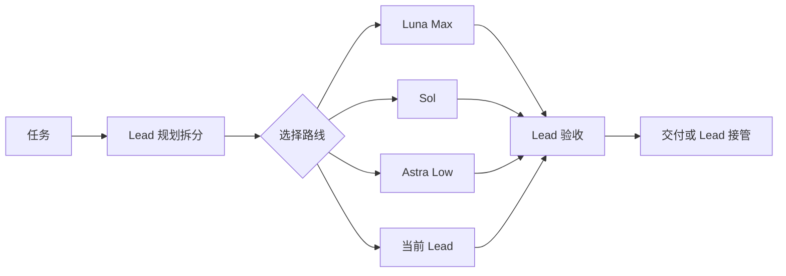
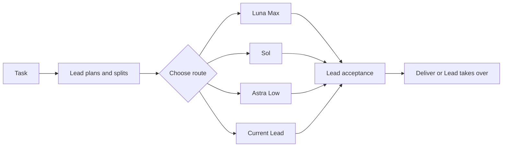

# Codex 路由矩阵

Lead 指当前 Astra 或 Sol 主控。Luna 明确不支持或无访问权限时，主控将原工作包和进度转给能可靠完成的 Sol 路线，并选择最低可靠档位；容量错误先由原代理在原上下文重试一次。质量失败由主控重新判断。

[中文](#中文) | [English](#english)

## 中文

Codex 路由矩阵是给 `gpt-6-astra` / `gpt-6.1-sol` 使用的多模型协作插件，已启动的 `gpt-6-sol` 仍兼容。它让 Lead 继续负责理解需求、规划、拆分、整合和最终验收，同时把边界清楚、适合独立执行的工作交给 Luna Max、Sol worker（Medium/High/XHigh/Max）、可选的 Astra Low。

它解决的不是“每个任务都换模型”，而是两个更实际的问题：复杂任务如何安全并行，以及如何在不降低质量的前提下减少不必要的高价模型调用。

### 运行原理

1. Lead 先理解任务，短任务或强耦合工作直接完成。
2. 需要拆分时，Lead 为每个工作单元写清目标、范围、文件归属、依赖和验收标准。
3. 对目标和上下文足够清楚、Luna Max 能可靠完成的边界单元，可把本地分析、实现、调试和测试交给 Luna；不把 Luna 当试错路线，也不依赖 Lead 事后救回不合适的结果。
4. `sol_medium_worker` 保留现有代理名，常规独立工作默认使用 High；边界清楚的轻量工作可显式选择 Medium，复杂独立单元可选择 XHigh。只有预计 XHigh 不足以完成的困难边界工作且下派有净收益时，才预先选择 Max；若 XHigh 能胜任，不选 Max。
5. Astra Low 仅在预期相对合适的 Sol 档位或当前 Lead 有明确质量或总成本收益时使用；不预设它强于 Sol XHigh，也不走自动升级梯子。
6. 互不依赖、不会同时修改同一文件且并行有净收益的工作可以并行。
7. Worker 完成后，Lead 检查真实改动、重跑必要验证并最终决定是否接受。能力不足、越界或质量不达标的工作直接回到 Lead。



### 模型分工

| 角色 | 负责什么 |
|---|---|
| 当前 Lead | 理解、规划、拆分、整合、验收和兜底 |
| Luna Max | 目标和上下文足够清楚、能可靠完成的边界工作，包括本地分析、实现、调试和测试 |
| Sol worker | High（默认）处理常规独立工作；轻量边界工作用 Medium，复杂独立工作用 XHigh；仅预计 XHigh 不足且下派有净收益的困难边界工作用 Max |
| Astra Low | 相对合适的 Sol 档位或当前 Lead 有明确质量或总成本收益的边界清楚执行工作；不默认优于 Sol XHigh |
| Sol Reviewer XHigh | 关键高风险改动的一次独立只读复审 |

质量优先并不等于默认使用最贵模型。已有能胜任且有相关上下文的代理优先继续处理；对需要新路线的工作单元，才先判断 Luna 是否适合，再考虑 Sol worker（Medium/High/XHigh/Max）、可选的 Astra Low 或当前 Lead。Max 仅用于预计 XHigh 不足且下派有净收益的困难边界工作；若 XHigh 能胜任，不选 Max。比较总成本时同时考虑交接、缓存、复审和返工成本，绝不假设一定命中缓存。路由一旦确定就保持不变，除非任务边界、可用性或结果发生变化。

常规独立工作默认使用 Sol High，边界清楚的轻量工作可选 Sol Medium，复杂独立工作可选 Sol XHigh；困难边界工作只有预计 XHigh 不足且下派有净收益时才选 Sol Max。Astra Low 不是自动升级路线。

### 普通模式与 Super mode

- 普通模式适合日常任务。短任务由当前 Lead 直接完成；只有下派确实有收益时才使用 Worker，通常从一个开始。
- Super mode 适合大量互不依赖、写入不冲突的工作。它支持四层拆分和最多 25 个子线程，但实际并发仍受当前 Codex 宿主容量限制。并发规模按有益工作决定，不为填满槽位增加 Worker。Lead 仍会验收全部结果，质量标准不会降低。

开启或关闭当前会话的 Super mode：

```text
开启爆种模式
关闭爆种模式
enable super mode
disable super mode
```

### 1M 上下文

1M 上下文默认关闭。下面的精确命令会在全局 `~/.codex/config.toml` 中写入或恢复上下文配置：

```text
开启1M上下文
关闭1M上下文
enable 1M context
disable 1M context
```

开启后写入 `model_context_window = 1000000` 和 `model_auto_compact_token_limit = 900000`。必须重启 Codex 并重新打开同一个任务才会生效；任务历史不会丢失。关闭时恢复开启前的原值。该模式只适合确实需要超长历史的任务。

### 安装

本插件尚未进入 OpenAI 公共插件商城。先添加这个 Git Marketplace，再安装插件：

```powershell
codex plugin marketplace add 9holy/codex-routing-matrix --ref main
codex plugin add codex-routing-matrix@codex-routing-matrix
```

首次安装后运行初始化脚本：

```powershell
powershell -NoProfile -ExecutionPolicy Bypass -File "$HOME\.codex\.tmp\marketplaces\codex-routing-matrix\plugins\codex-routing-matrix\scripts\install.ps1"
```

macOS、Linux 桌面或 Linux 服务器上的 Codex CLI 直接运行跨平台初始化器：

```bash
node "$HOME/.codex/.tmp/marketplaces/codex-routing-matrix/plugins/codex-routing-matrix/scripts/portable-setup.cjs" install
```

初始化会安装四个具名代理配置（Sol 支持 Medium/High/XHigh/Max），写入无编号的 `Codex Routing Matrix`，并在 `AGENTS.md` 顶部加入一次性的英文 `Meta Rule - Conflict Resolution` 和 `Implementation`。后两条不会被以后安装或配置守护自动恢复、覆盖。

在 `/hooks` 中检查并信任四个 Hook，然后新建任务。升级后只有 Hook 内容发生变化时才需要重新信任。

如果 Cockpit Tools、CC Switch 等工具会覆盖 `config.toml`，再启用配置守护：

```powershell
powershell -NoProfile -ExecutionPolicy Bypass -File "$HOME\.codex\.tmp\marketplaces\codex-routing-matrix\plugins\codex-routing-matrix\scripts\config-guard.ps1" -Mode Install
```

配置守护目前只支持 Windows。macOS 或 Linux 不运行 `config-guard.ps1 -Mode Install`；核心路由和四个 Worker profile 仍可正常使用。

详细说明：[操作指南](docs/OPERATING_GUIDE.md) · [路由矩阵](docs/ROUTING_MATRIX.md) · [需求基线](docs/REQUIREMENTS.md)

## English

Lead means the current Astra or Sol controller. If Luna is unsupported or access is denied, use the capable Sol route and its lowest reliable effort with the same packet and progress; retry capacity errors once in the original agent context first.

Codex Routing Matrix gives a `gpt-6-astra` / `gpt-6.1-sol` controller a small multi-model team; an already-started `gpt-6-sol` controller remains supported. Lead keeps ownership of understanding, planning, decomposition, integration, and final acceptance. It delegates only bounded work that Luna Max, Sol (Medium/High/XHigh/Max), or Astra Low can reliably complete.

The plugin is not designed to switch models for every prompt. It is designed to parallelize larger work safely and avoid expensive routes when a lower-cost capable route can deliver the same quality.

### How it works

1. Lead understands the request and handles short or tightly coupled work directly.
2. When decomposition helps, Lead freezes each unit's goal, scope, file ownership, dependencies, and acceptance checks.
3. For bounded work with a clear goal and sufficient context that Luna Max can reliably complete, delegate local analysis, implementation, debugging, and tests to Luna. Never use it as a trial route or rely on Lead to rescue a poor fit.
4. Keep the compatible `sol_medium_worker` name; use High by default for routine independent work, Medium for bounded light reasoning, and XHigh for complex independent work. Select Max upfront only for difficult bounded work expected to exceed XHigh when delegation has net value; if XHigh is capable, do not use Max.
5. Select Astra Low only for a clear predicted quality or total-cost benefit over the suitable Sol effort or current Lead; do not presume it is stronger than Sol XHigh, and never make it an automatic escalation step.
6. Independent, write-safe units may run in parallel when the benefit exceeds coordination cost.
7. Lead inspects the real changes, reruns necessary checks, and accepts or rejects every result. Capability, scope, or quality failures return directly to Lead.



### Model roles

| Role | Responsibility |
|---|---|
| Current Lead | Understand, plan, split, integrate, verify, and fall back |
| Luna Max | Bounded work with a clear goal and sufficient context, including local analysis, implementation, debugging, and tests, when it can reliably complete the unit |
| Sol worker | High by default for routine independent work; Medium for bounded light reasoning; XHigh for complex independent work; Max only when a difficult bounded unit is expected to exceed XHigh and delegation has net value |
| Astra Low | Bounded work with a clear predicted quality or total-cost benefit over the suitable Sol effort or current Lead; do not presume it is stronger than Sol XHigh |
| Sol Reviewer XHigh | One independent read-only review for a critical high-risk change |

Quality first does not mean selecting the most expensive model by default. Reuse a capable agent with relevant context before choosing a fresh route; for a unit that needs a new route, check whether Luna can reliably complete the bounded work with sufficient context, then consider Sol High by default, Sol Medium for bounded light reasoning, Sol XHigh for complex independent work, or Sol Max only when a difficult bounded unit is expected to exceed XHigh and delegation has net value. If XHigh is capable, do not use Max. Astra Low remains optional only for a clear predicted benefit over the suitable Sol effort or current Lead. Compare execution, handoff, cache, review, and rework costs, and never assume a cache hit. Once selected, a route stays frozen until the unit, availability, or result changes.

### Normal mode and Super mode

- Normal mode is for everyday work. Lead handles short tasks directly and starts with one Worker only when delegation has net value.
- Super mode is for many independent, write-safe units. It supports four delegation levels and up to 25 child threads, subject to the active Codex host's real capacity. Size concurrency for useful work instead of filling slots. Lead still verifies every result and keeps the same quality bar.

Toggle Super mode for the current session:

```text
enable super mode
disable super mode
开启爆种模式
关闭爆种模式
```

### 1M context

1M context is off by default. These exact commands write or restore the global context settings in `~/.codex/config.toml`:

```text
enable 1M context
disable 1M context
开启1M上下文
关闭1M上下文
```

Enabling writes `model_context_window = 1000000` and `model_auto_compact_token_limit = 900000`. Restart Codex and reopen the same task to apply the settings; its history is preserved. Disabling restores the values that existed before enabling. This mode is intended only for tasks that genuinely need very long history.

### Install

The plugin is not yet listed in OpenAI's public plugin marketplace. Add its Git Marketplace, then install it:

```powershell
codex plugin marketplace add 9holy/codex-routing-matrix --ref main
codex plugin add codex-routing-matrix@codex-routing-matrix
```

Run first-install setup:

```powershell
powershell -NoProfile -ExecutionPolicy Bypass -File "$HOME\.codex\.tmp\marketplaces\codex-routing-matrix\plugins\codex-routing-matrix\scripts\install.ps1"
```

On macOS, Linux desktops, or Linux servers running Codex CLI, use the portable setup entry directly:

```bash
node "$HOME/.codex/.tmp/marketplaces/codex-routing-matrix/plugins/codex-routing-matrix/scripts/portable-setup.cjs" install
```

Setup installs four named agent profiles (Sol supports Medium/High/XHigh/Max), adds the unnumbered `Codex Routing Matrix` section, and places one-time English `Meta Rule - Conflict Resolution` and `Implementation` defaults at the top of `AGENTS.md`. Later installs and the configuration guard do not restore or overwrite those two defaults.

Review and trust all four Hooks in `/hooks`, then start a new task. Trust must be renewed only when an update changes Hook content.

Use `config-guard.ps1 -Mode Install` only when another tool may replace `config.toml`.

The configuration guard is currently Windows-only. Do not run `config-guard.ps1 -Mode Install` on macOS or Linux; core routing and all four agent profiles remain supported.

Detailed documentation: [Operating Guide](docs/OPERATING_GUIDE.en.md) · [Routing Matrix](docs/ROUTING_MATRIX.en.md) · [Requirements](docs/REQUIREMENTS.en.md)

## License

[MIT](LICENSE)
